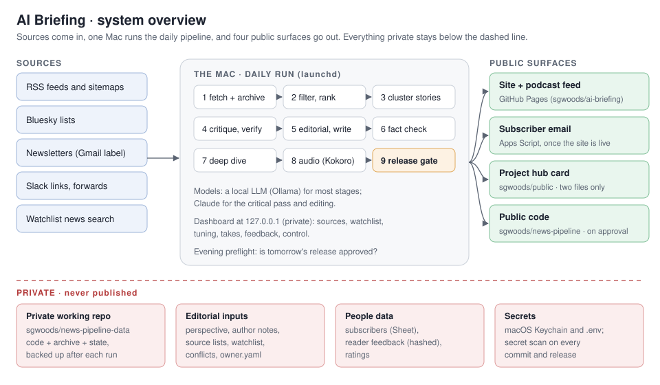
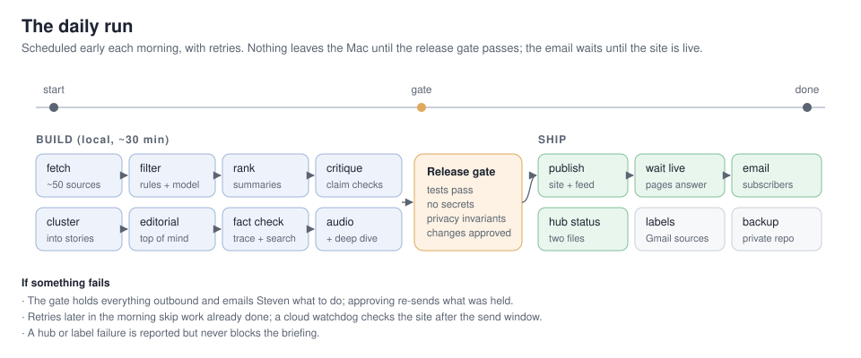
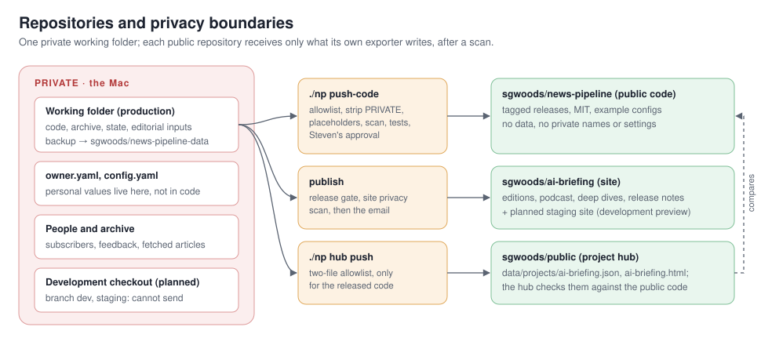
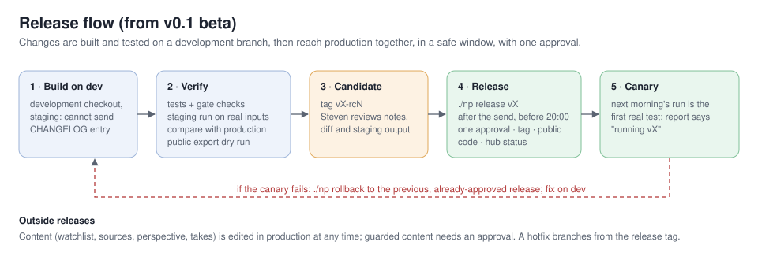

# Architecture

AI Briefing is a daily AI briefing for early-stage investors: a written edition, a ~10-minute podcast episode with
the day's deep dive, a static site and podcast feed, and a subscriber email. One machine runs the whole pipeline
each morning, mostly with local models. Nothing reaches readers until a release gate has passed.

This page describes the design as of **v0.1 beta**. Release notes: `CHANGELOG.md` and the site's
[release notes](https://sgwoods.github.io/ai-briefing/releases/index.html). Project page:
[sgwoods.github.io/public/ai-briefing.html](https://sgwoods.github.io/public/ai-briefing.html).

## Current facts
_Generated at build time._

- **Release:** v0.1.5-beta (2026-10-22)
- **Schedule:** daily at 05:00, 06:30, 07:30 (local time; later times are retries)
- **Local model:** qwen3:30b
- **Modules:** 57 in `pipeline/`

## Contents
- Design principles
- The daily run
- Components
- Data and storage
- Privacy and security
- Repositories and public surfaces
- Releases
- Operations
- Component reference
- Running your own instance

## Design principles
- **Evidence over volume.** Sources are weighed by how they know things (primary, reporting, analysis, opinion,
  aggregator, social), not by how many repeat a claim. A Must read needs primary or reporting evidence.
- **Check before sending.** Figures are traced to their sources and searched for before they are cut. Big claims get
  a critical read. Thin items have their article read.
- **Local first.** A local model (Ollama or LM Studio) handles most stages, Claude the critical pass and editing.
  Audio is local Kokoro TTS. Free and local tools come before paid services.
- **Fail safe, not silent.** An outbound step that can't pass the gate holds the work and tells the owner what to
  do. It never sends half-checked output.
- **Private by construction.** Personal values live in one private file, not in code. Public outputs are scanned
  for private terms before they leave.
- **Data, never instructions.** Everything fetched (posts, newsletters, replies, pages) is treated as content to
  assess, never as commands.

## The daily run

| Stage | What happens | Module |
|---|---|---|
| fetch | New items from every verified source: RSS and sitemaps, Bluesky lists, a newsletter label (read-only IMAP), shared Slack links, watchlist news search. Archived append-only. | `fetch.py`, `pages.py`, `bluesky.py`, `mailsource.py`, `slacksource.py`, `watchlist.py`, `archive.py` |
| filter | Rules drop known noise, then a model keeps what matters to the audience. | `stages.py` |
| summarize / rank | A summary, tags and a relevance score per item; the best are read in full. | `stages.py`, `reader.py` |
| cluster | Items about the same thing become one story, with an evidence mix. | `editorial.py`, `profiles.py` |
| critique / verify | Each claim gets a verdict: holds, mixed, overstated, unsupported, unverified. Every Must read gets an evidence check. | `stages.py`, `dive.py` |
| editorial / write | Day in brief, Top of mind, Must read, Worth knowing, Open questions; citations point at the real article. | `editorial.py`, `links.py`, `questions.py` |
| fact check | Figures traced to their source, searched before they are cut, flagged when unconfirmed; numbers cross-checked. | `factcheck.py`, `factsearch.py`, `numbers.py` |
| deep dive | A second segment on the day's focal topic, from a queue the owner curates. | `deepdive.py` |
| audio | The script becomes speech (pronunciations, pacing), the briefing and the deep dive joined into one episode. | `audio.py`, `speech.py` |
| release gate | Tests, a secret scan, privacy invariants, approval of security-sensitive changes. | `release.py` |
| publish | The static site, RSS and the podcast feed, after a privacy scan; then a wait until the pages answer. | `site.py`, `publish.py`, `episodes.py` |
| email | The edition to subscribers through an Apps Script mailer, only once the site is live. | `mailer.py` |
| hub status | The project's status file and page on the public project hub. | `hub.py` |
| afterwards | Source labels in the mailbox, reader feedback collected and triaged, a quality scorecard, a private backup. | `mailsource.py`, `feedback.py`, `quality.py`, `publish.py` |

A run records every stage's status, counts and timings (`runlog.py`). A short report goes in `logs/last-report.md`.

## Components
- **Models** (`llm.py`): one small interface over a local OpenAI-compatible server, Claude via the CLI, or Claude
  via the API. Each stage picks its backend in config.
- **Editorial lens** (`perspective.py`): a hand-written perspective file (people, topics, scepticism) steers
  filtering and the editor's view. Code reads it and never rewrites it.
- **Tuning** (`tuning.py`, `profiles/`): named presets for lengths, sections and tone, edited from the dashboard.
- **Dashboard** (`dashboard/`): a local Flask app on 127.0.0.1 for sources, watchlist, tuning, takes, feedback,
  runs, quality and control. It's never exposed to the internet.
- **Services** (`service.py`): launchd agents for the daily run, the evening preflight and the dashboard.
- **Secrets** (`vault.py`): macOS Keychain first, then `.env` (gitignored, mode 600).

## Data and storage
- **Archive:** append-only files under `data/` (items, analyses, stories, runs). Nothing deletes or rewrites history.
- **Editions:** `briefings/<day>.md`, the audio and the deep dives. The site is rebuilt from these each publish.
- **Editorial inputs:** the perspective, source lists, newsletter rules, watchlist, source profiles and
  pronunciations. They're hand-edited or edited from the dashboard.
- **People:** subscribers live in a Google Sheet behind the mailer. Feedback is stored with a hashed sender id and a
  first name only.
- **State:** seen-message lists, release approvals, alerts. Everything private is committed to a private repository
  and backed up after each run.

## Privacy and security
- **Release gate** (`release.py`): every outbound action (site, email, Gmail label writes, backups, hub, public code)
  calls `require()`. It re-runs the tests, the secret scan and the invariants when code changes, and needs the
  owner's approval of security-sensitive files. Invariants include:
  - mailbox access only through a least-privilege guard;
  - no private author notes in any prompt;
  - outbound URLs from content checked against an allowlist (`netguard.py`);
  - every outbound function behind the gate.
- **Mailbox** (`mailguard.py`): one IMAP wrapper. Each purpose may open only its own labels, read-only except for
  adding labels.
- **Scans:** the site, every email and every public export are scanned for private names, the owner's addresses,
  private links and trackers before they leave.
- **Owner details:** names, addresses, organization and bio live in `owner.yaml`, which is never public. Code
  defaults are neutral placeholders.
- **Staging** (`env.py`): a development checkout can't reach readers. The gate refuses every outbound action there,
  and the mailer only sends review copies to the owner, marked [STAGING].

## Repositories and public surfaces

| Repository | Contents | Written by |
|---|---|---|
| private working repo | code, archive, state, editorial inputs | the daily run and the owner; backed up after each run |
| [sgwoods/news-pipeline](https://github.com/sgwoods/news-pipeline) | this code, tagged releases, example configs | `./np push-code`: allowlisted export, PRIVATE blocks removed, placeholders, scan, tests, owner's approval |
| sgwoods/ai-briefing | the public site, RSS and podcast feed, release notes | `publish`, after the gate and the site scan |
| [sgwoods/public](https://github.com/sgwoods/public) | the project hub's status file and page for AI Briefing | `./np hub push`: two files only, and only for the released public code |

## Releases

Production runs a tagged release (`VERSION`, `CHANGELOG.md`). Changes are built on a development branch whose
checkout is in staging mode. They're verified with a full staging run compared against production, tagged as a
release candidate, reviewed, and promoted in a safe window with a single approval. The next morning's run is the
canary, and a rollback returns to the previous, already-approved release. Editorial content (sources, watchlist,
perspective, takes) isn't code and is edited in production at any time.

| Command | Where | What |
|---|---|---|
| `./np dev setup` | production | creates the development checkout (branch `dev`, staging) |
| `./np staging sync` | dev | brings in production's latest data and fixes |
| `./np staging run [DAY]` | dev | rebuilds an edition with the dev code; outbound off, review email to the owner only |
| `./np release VERSION "reviewed: ..."` | production | merges dev with one approval, then tags it and updates the public code, backup and hub |
| `./np rollback "reviewed: ..."` | production | returns the code to the previous release |

Modules: `env.py` (production or staging), `devenv.py` (the development checkout), `releaser.py` (release and
rollback), `release.py` (the gate).

## Operations
- **Schedule:** early morning with two retries. A retry skips work already done. An evening preflight checks
  that tomorrow's release is approved.
- **When something needs the owner:** an action-needed email states the issue and the fix. Approving re-sends
  what was held back.
- **Outside view:** a cloud watchdog checks the public site after the send window, and the project hub compares
  the exported release with the public code.
- **Commands:** `./np help`. Every command saves its full output under `logs/`.

## Component reference
_Generated from each module's own description at build time._

| Module | Purpose |
|---|---|
| `alerts.py` | Action-needed email to Steven when the daily edition can't go out (Steven, 2026-10-19 |
| `archive.py` | Append-only archive on plain files. |
| `audio.py` | Phase 2 |
| `bluesky.py` | Bluesky lists and Steven's own posts as sources, via the public AT Protocol API (no key, no login). |
| `deepdive.py` | Topical deep dive |
| `devenv.py` | The development checkout |
| `dive.py` | Deep dive on one story |
| `docs.py` | Public documentation on the site |
| `editor_note.py` | Steven's private evening note |
| `editorial.py` | Briefing v2 |
| `env.py` | Production or staging. |
| `episodes.py` | Which days are published |
| `factcheck.py` | Claim-to-source trace for the written edition (fact review 2026-10-18, P1-1). |
| `factsearch.py` | Look for a figure before the fact check cuts it (Steven, 2026-10-18 |
| `feedback.py` | Reader feedback |
| `fetch.py` | Fetch new items from every verified source. |
| `hub.py` | AI Briefing on Steven's public project hub (sgwoods.github.io/public) |
| `linkedin.py` | Steven's own LinkedIn posts, from LinkedIn's data export (and from Slack, when he shares one there). |
| `links.py` | Make every citation point at the real article (runs in the write stage; never fails the briefing). |
| `llm.py` | LLM backends behind one tiny interface |
| `mailer.py` | Daily email to subscribers, sent through Steven's Google Apps Script (scripts/apps-script/Code.gs). |
| `mailguard.py` | The only way the pipeline talks to Gmail |
| `mailsource.py` | Newsletters as a source |
| `netguard.py` | Requests to URLs that came from content (links in posts, newsletters, model output) may only reach the public internet |
| `numbers.py` | Number check for one edition |
| `owner.py` | Who runs this instance |
| `pages.py` | Sources without RSS |
| `perspective.py` | Read-only parser for perspective.md. |
| `profiles.py` | Source profiles (source_profiles.yaml) |
| `publish.py` | Push the static site (site/) to a separate public GitHub repo served by GitHub Pages. |
| `quality.py` | Daily quality scorecard |
| `questions.py` | Open questions from the briefings (editorial.open_questions), with a status you keep on the Questions page. |
| `reader.py` | Read the article behind a thin item before its evidence check. |
| `record.py` | Public record |
| `release.py` | Release gate |
| `releaser.py` | Promote a release from dev to production, or roll production back (docs/plans/release-process.md). |
| `report.py` | Compact, paste-friendly status report → logs/last-report.md. |
| `review.py` | Weekly quality review, run on the Mac from local files only (no web, no tools, no mailbox). |
| `runlog.py` | Records every run |
| `schedule.py` | When the scheduled jobs actually run |
| `scrub.py` | Scrubbing shared by the public code export and the public docs |
| `service.py` | Background services on macOS (launchd user agents) + health of what the pipeline depends on. |
| `settings.py` | Change single values in config.yaml without disturbing comments or layout. |
| `site.py` | Static, phone-friendly public site |
| `slacksource.py` | Links Steven shares in an internal Slack channel, as a source (read-only, Slack Web API, free). |
| `sources.py` | Resolve and verify RSS/Atom feeds for every tracked person. |
| `speech.py` | The speech layer |
| `stages.py` | LLM stages |
| `suggest.py` | Source suggestions |
| `textutil.py` | HTML → text, page metadata, URL ids, and date parsing. |
| `todos.py` | A shared to-do list for Steven and Claude |
| `tuning.py` | Tuning profiles |
| `vault.py` | Secrets |
| `version.py` | The running version |
| `watchlist.py` | Company watchlist |
| `xdigest.py` | Weekly X digest by Claude web search, for the accounts in x.yaml no mirror can reach. |
| `xsource.py` | X / Twitter accounts via Nitter-style mirrors (public RSS), never via X's paid API. |

## Running your own instance
See the README: copy `owner.example.yaml` and `source_profiles.example.yaml`, write your own `config.yaml`,
`sources.yaml` and `perspective.md`, then run `./np tests` and `./np run`.
