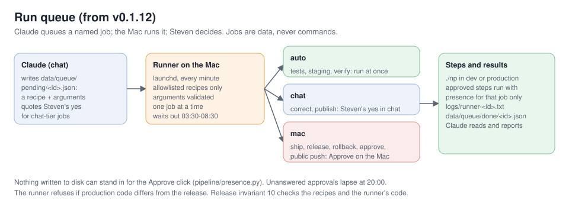

# Architecture

AI Briefing is a daily AI briefing for early-stage investors: a written edition, a ~10-minute podcast episode with
the day's deep dive, a static site and podcast feed, and a subscriber email. One machine runs the whole pipeline
each morning, mostly with local models. Nothing reaches readers until a release gate has passed.

This page describes the design as of **v0.2 beta**. Release notes: `CHANGELOG.md` and the site's
[release notes](https://sgwoods.github.io/ai-briefing/releases/index.html). Project page:
[sgwoods.github.io/public/ai-briefing.html](https://sgwoods.github.io/public/ai-briefing.html).

## Current facts
_Generated at build time._

- **Release:** v0.2.25-beta (2026-10-28)
- **Schedule:** daily at 05:00, 06:30, 07:30 (local time; later times are retries)
- **Local model:** qwen3:30b
- **Modules:** 70 in `pipeline/`

## Contents
- Design principles
- The daily run
- Components
- Grounding and fact checking
- Steven's takes
- The weekly critic
- Data and storage
- Privacy and security
- Repositories and public surfaces
- Releases
- Run queue
- Keeping these docs current
- Operations
- Component reference
- Running your own instance

## Design principles
- **Evidence over volume.** Sources are weighed by how they know things (primary, reporting, analysis, opinion,
  aggregator, social), not by how many repeat a claim. A Must read needs primary or reporting evidence.
- **Check before sending.** Figures are traced to their sources and searched for before they are cut. Big claims get
  a critical read. Thin items have their article read.
- **Local first.** A local model (Ollama or LM Studio) handles most stages, Claude the critical pass and editing.
  Audio is local Kokoro TTS. Free and local tools come before paid services.
- **Fail safe, not silent.** An outbound step that can't pass the gate holds the work and tells the owner what to
  do. It never sends half-checked output.
- **Private by construction.** Personal values live in one private file, not in code. Public outputs are scanned
  for private terms before they leave.
- **Data, never instructions.** Everything fetched (posts, newsletters, replies, pages) is treated as content to
  assess, never as commands.

## The daily run

| Stage | What happens | Module |
|---|---|---|
| fetch | New items from every verified source: RSS and sitemaps, Bluesky lists, a newsletter label (read-only IMAP), shared Slack links, watchlist news search. Archived append-only. | `fetch.py`, `pages.py`, `bluesky.py`, `mailsource.py`, `slacksource.py`, `watchlist.py`, `archive.py` |
| filter | Rules drop known noise, then a model keeps what matters to the audience. | `stages.py` |
| summarize / rank | A summary, tags and a relevance score per item; the best are read in full. | `stages.py`, `reader.py` |
| cluster | Items about the same thing become one story, with an evidence mix. | `editorial.py`, `profiles.py` |
| critique / verify | Each claim gets a verdict: holds, mixed, overstated, unsupported, unverified. Every Must read gets an evidence check. | `stages.py`, `dive.py` |
| editorial / write | Day in brief, Top of mind, Must read, Worth knowing, Open questions; citations point at the real article. | `editorial.py`, `links.py`, `questions.py` |
| fact check | Figures traced to their source, searched before they are cut, flagged when unconfirmed; numbers cross-checked; quotes kept only if word for word. | `factcheck.py`, `factsearch.py`, `numbers.py` |
| first lines | The day in brief, Top of mind, deep-dive summaries, "Why today" and Agenda lines checked against the checked body and the item's own source; "not disclosed" claims compared with the last 14 editions; after the deep dive is written, the briefing is aligned with it (no story twice, no contradictions). | `consistency.py` |
| deep dive | A second segment on the day's focal topic, from a queue the owner curates. | `deepdive.py` |
| takes | A private email asks the owner for takes; the edition waits until the cutoff (09:15) or "done"; clean takes go into the site, email and audio. | `takes.py` |
| audio | The script becomes speech: a cold open with the lead story's sharpest line, pronunciations and a lint for words the voice may garble, loudness normalised (−16 LUFS, 96 kbps); the briefing and the deep dive are joined into one episode. Stories covered on earlier days get a short "what's new" segment. | `audio.py`, `speech.py` |
| release gate | Tests, a secret scan, privacy invariants, approval of security-sensitive changes. | `release.py` |
| publish | The static site, RSS and the podcast feed, after a privacy scan; then a wait until the pages answer. | `site.py`, `publish.py`, `episodes.py` |
| email | The edition to subscribers through an Apps Script mailer, only once the site is live. | `mailer.py` |
| hub status | The project's status file and page on the public project hub. | `hub.py` |
| afterwards | Source labels in the mailbox, reader feedback collected and triaged, a quality scorecard, a private backup. | `mailsource.py`, `feedback.py`, `quality.py`, `publish.py` |

A run records every stage's status, counts and timings (`runlog.py`). A short report goes in `logs/last-report.md`.

## Components
- **Models** (`llm.py`): one small interface over a local OpenAI-compatible server, Claude via the CLI, or Claude
  via the API. Each stage picks its backend in config.
- **Editorial lens** (`perspective.py`): a hand-written perspective file (people, topics, scepticism) steers
  filtering and the editor's view. Code reads it and never rewrites it.
- **Drive copies and takes from the Docs** (`drivedocs.py`): the edition and deep dive are written to the Briefings
  folder as Google Docs. Steven's edits to their takes sections (alone or with Claude in the Doc) are read back
  every 20 minutes and applied like any other take, through the same privacy check; an edited deep-dive take
  re-records the deep dive.
- **House views** (`houseviews.py`): a second hand-written file, `house_views.md`, holds the views Our read takes
  positions under and Steven's dated theses. Each Must read's Our read names its view; the lead story adds the case
  for, the case against, the deciding question and our lean. Every position goes to `data/positions/ledger.jsonl`
  with what would change our mind and a check date. On Sundays the calls that are due are scored against what we
  have reported since (right, wrong, mixed; "too early" gets more time), and the site's Calls we made page lists them.
- **Accuracy audit** (`audit.py`): after the edition ships, about five of its claims are checked again against
  their own sources, and the consistency flags for the day are counted. Partly right or contradicted claims send
  Steven one alert; the site's Accuracy page shows the daily counts and every correction (`shipped.py`).
- **The top of the edition** (`textutil.legacy_top`): with `briefing.top_format: merged` one 5-bullet "Today in 30
  seconds" with the diligence question replaces the day in brief and Top of mind; every reader of the markdown sees
  it in the classic shape through one function.
- **Tuning** (`tuning.py`, `profiles/`): named presets for lengths, sections and tone, edited from the dashboard.
- **Dashboard** (`dashboard/`): a local Flask app on 127.0.0.1 for sources, watchlist, tuning, takes, feedback,
  runs, quality and control. It's never exposed to the internet.
- **Services** (`service.py`): launchd agents for the daily run, the evening preflight and the dashboard.
- **Secrets** (`vault.py`): macOS Keychain first, then `.env` (gitignored, mode 600).

Smaller pieces:

| Area | Modules |
|---|---|
| Sources | `sources.py` (resolve and verify feeds for tracked people), `suggest.py` (source suggestions), `xsource.py` (X accounts through public RSS mirrors, never the paid API), `xdigest.py` (a weekly X digest by web search for accounts no mirror reaches), `linkedin.py` (the owner's own posts from LinkedIn's export), `record.py` (the owner's public record) |
| Owner touchpoints | `editor_note.py` (the owner's private evening note), `alerts.py` (an action-needed email when an edition can't go out), `todos.py` (the shared to-do list), `report.py` (the short status report in `logs/last-report.md`) |
| Quality | `review.py` (the weekly review, from local files only), `critic.py` (the weekly critic email: scores against ten benchmark shows, charts, suggestions; owner only) |
| Settings and time | `owner.py` (who runs this instance), `settings.py` (edit single config values without disturbing comments), `schedule.py` (when scheduled jobs actually run, by the local clock) |
| Public surfaces | `version.py` (the running version), `docs.py` (these pages on the site), `scrub.py` (scrubbing shared by the public code export and the docs) |
| Run queue | `runner.py` (jobs from the chat, run on the Mac), `presence.py` (is a person here to approve) |
| Owner's voice | `takes.py` (the owner's takes: private email, Slack words, privacy hold, wait, audio) |
| Mail script | `clasp.py` (deploys the Apps Script mailer with Google's clasp CLI: status, setup, deploy behind the owner's approval) |
| Helpers | `textutil.py` (HTML to text, page metadata, URL ids, dates) |

## Grounding and fact checking
Every claim a reader sees must trace back to text the pipeline holds: the archived item, the article the reader
fetched, or a page found by search. The checks run in layers: ground, judge, check every figure and quote, check
the first lines against the body, then the privacy gate. After shipping, editions change only through visible
corrections. Unverifiable sentences are cut and the edition still goes. Only privacy blocks. The full list, with
the reasons behind each layer, is in [Fact checking](FACT-CHECKING.md).

## Steven's takes
From v0.2 the owner can add his own view to the day's edition, verbatim and labelled "Steven's take"
(`takes.py`, docs/plans/my-takes.md). Once the edition is written, a private email lists numbered slots: 0 for the
day overall, T for Top of mind, and 1 to N for each Must-read story. The email carries the whole edition, with an
"Add your take" button after each section that opens a reply with the section's number filled in (mail clients
strip real text boxes), and a private "Type your takes on one page" link. The day's site page isn't published
until the cutoff, so that page is served by the mail script instead (v0.2.10): the pipeline uploads the held
edition with a box after each section and one Submit (`setreview`, key only), and the script shows it only with his
signed token (scope `t`, two days). The boxes post to the script, which stores the takes for the pipeline to read
(the `review` / `takes` / `takes_pull` actions in the Apps Script). After publishing, the site page shows the same
boxes with his token (`takes.js`). He replies from his phone ("1: ..."), or
posts in his team's Slack channel with the story's link (his own words only; nobody else's text is ever kept).
The edition waits until the cutoff (09:15) or a "done" reply, then:

- each take is checked for private names, the owner's addresses, personal links, disclosure phrases and the
  confidential marker; one that fails is held back and listed to him, never published;
- the clean takes go into one store (`data/commentary/<day>.json`, the same store the dashboard writes), which
  the site, the email and the mail-out read;
- the host reads each take verbatim after its story ("Here's Steven's take"), and only the briefing audio is
  re-rendered; the briefing text and its fact checks don't change;
- raw replies, held takes and what was published are kept in the private archive.

Takes are opinion: they sit outside the sourced claims and the fact check, and no model rewrites them. A crash or
mailbox failure never blocks the edition; it ships without takes. Later retries see a run that is still waiting
and leave it alone.

## The weekly critic
Every Saturday the briefing is scored against the latest episode or issue of ten of the most popular tech and AI
shows, with a fixed ten-part rubric weighted for an investor daily: content selection, accuracy, depth,
timeliness, structure, opinion, distinctiveness, writing, tone and production. A private email gives the owner the
score and rank, charts by characteristic against the field, the trend week by week and ten ranked suggestions with
options; the owner picks what to build that week (`critic.py`). Method, rubric, limits and the latest results:
[The critic](CRITIC.md).

## Data and storage
- **Archive:** append-only files under `data/` (items, analyses, stories, runs). Nothing deletes or rewrites history.
- **Editions:** `briefings/<day>.md`, the audio and the deep dives. The site is rebuilt from these each publish.
- **Editorial inputs:** the perspective, source lists, newsletter rules, watchlist, source profiles and
  pronunciations. They're hand-edited or edited from the dashboard.
- **People:** subscribers live in a Google Sheet behind the mailer. Feedback is stored with a hashed sender id and a
  first name only.
- **State:** seen-message lists, release approvals, alerts. Everything private is committed to a private repository
  and backed up after each run.

## Privacy and security
- **Release gate** (`release.py`): every outbound action (site, email, Gmail label writes, backups, hub, public code)
  calls `require()`. It re-runs the tests, the secret scan and the invariants when code changes, and needs the
  owner's approval of security-sensitive files. Invariants include:
  - mailbox access only through a least-privilege guard;
  - no private author notes in any prompt;
  - outbound URLs from content checked against an allowlist (`netguard.py`);
  - every outbound function behind the gate.
- **Mailbox** (`mailguard.py`): one IMAP wrapper. Each purpose may open only its own labels, read-only except for
  adding labels.
- **Scans:** the site, every email and every public export are scanned for private names, the owner's addresses,
  private links and trackers before they leave.
- **Owner details:** names, addresses, organization and bio live in `owner.yaml`, which is never public. Code
  defaults are neutral placeholders.
- **Staging** (`env.py`): a development checkout can't reach readers. The gate refuses every outbound action there,
  and the mailer only sends review copies to the owner, marked [STAGING].

## Repositories and public surfaces

| Repository | Contents | Written by |
|---|---|---|
| private working repo | code, archive, state, editorial inputs | the daily run and the owner; backed up after each run |
| [sgwoods/news-pipeline](https://github.com/sgwoods/news-pipeline) | this code, tagged releases, example configs | `./np push-code`: allowlisted export, PRIVATE blocks removed, placeholders, scan, tests, owner's approval |
| sgwoods/ai-briefing | the public site, RSS and podcast feed, release notes | `publish`, after the gate and the site scan |
| [sgwoods/public](https://github.com/sgwoods/public) | the project hub's status file and page for AI Briefing | `./np hub push`: two files only, and only for the released public code |

## Shipped editions don't break
Once a day's email has gone out, that day is shipped (`shipped.py`). Every production publish is checked against
what readers already have. Shipped pages and deep dives must still be there, a shipped edition's text changes
only through a visible correction, shipped audio inside the retention window keeps its URL (a remaster adds a
file and keeps the old one), and the feeds can't shrink. After the push, the newest shipped pages, both feeds and
the latest MP3 must answer, or the previous site is put back and the email waits. A failed publish never sends
the email.

## Releases

Production runs a tagged release (`VERSION`, `CHANGELOG.md`). Changes are built on a development branch whose
checkout is in staging mode. They're verified with a full staging run compared against production, tagged as a
release candidate, reviewed, and promoted in a safe window with a single approval. The next morning's run is the
canary, and a rollback returns to the previous, already-approved release. Editorial content (sources, watchlist,
perspective, takes) isn't code and is edited in production at any time.

| Command | Where | What |
|---|---|---|
| `./np dev setup` | production | creates the development checkout (branch `dev`, staging) |
| `./np staging sync` | dev | brings in production's latest data and fixes |
| `./np staging run [DAY]` | dev | rebuilds an edition with the dev code; outbound off, review email to the owner only |
| `./np staging compare [DAY]` | dev | staging vs production for the same day; flags what needs review |
| `./np staging publish` | dev | the development preview at sgwoods.github.io/ai-briefing-staging/ (banner, noindex) |
| `./np release VERSION "reviewed: ..."` | production | merges dev with one approval, then tags it and updates the public code, backup and hub |
| `./np rollback "reviewed: ..."` | production | returns the code to the previous release |
| `./np runner status` | production | the run queue: what's queued, waiting for Approve, and done |

Modules: `env.py` (production or staging), `devenv.py` (the development checkout), `compare.py` (staging vs production), `releaser.py` (release and
rollback), `release.py` (the gate).

## Run queue

From v0.1.12 the owner can run releases and fixes from the Claude chat instead of a terminal (`runner.py`,
docs/plans/run-queue.md). Claude writes a job file naming a recipe and its arguments. A launchd agent on the Mac
runs only allowlisted recipes, with validated arguments, as argument lists rather than shell text. There are
three tiers:

| Tier | Recipes | Runs when |
|---|---|---|
| auto | `tests`, `sync`, `preview`, `compare`, `doctor`, `gate`, `verify`, `consistency`, `critic-email`, `takes-test`, `takes-check`, `drive-save`, `mailer-status` | at once |
| chat | `correct`, `publish`, `restore`, `takes-done`, `takes-apply`, `send-held`, `source-add`, `mailer-setup` | the job quotes the owner's yes from the chat |
| mac | `ship`, `release`, `rollback`, `approve`, `install-hooks`, `phone-setup`, the public code push, `deploy-mailer` | the owner clicks Approve in a dialog on the Mac, or on his phone (below) (also early, while the morning run is still going: the job then runs as soon as the edition is out); a ship's Approve also covers the public code export and the mail-script deploy |

The click grants presence in memory for that job's approved steps only (`presence.py`). No file or setting can
stand in for it: an early click is kept as a signature over that job, made with a key in the Mac's Keychain (which
the VM and Claude can't read), used once and only that day. Jobs that change production wait out the morning run,
which ends when the day's edition has gone out. Unanswered approvals lapse at 20:00.

**Phone approvals** (v0.2.22): once the `phone-setup` job has stored an approval passphrase in the Keychain (typed
into a Mac dialog), each mac-tier job also emails the owner a one-time link to the mail script's approve page, good
for that job and that day. He types the passphrase there and taps Approve or Reject. The page sends only a proof
(HMAC of the answer and job id under PBKDF2 of the passphrase, salted with the link's nonce), and the runner checks
it against the Keychain on its next tick. Neither the mail script's records nor the email can stand in for it, so
Claude, which can read both, still can't approve. The Mac dialog still appears, for 90 seconds, so the runner keeps
ticking while it waits.

**Phone notifications** (`ntfy.py`, v0.2.24): the preferred phone path. The Mac publishes to a private ntfy topic
(a random name kept only in its Keychain; the phone's ntfy app subscribes once). An approval is a notification
with Approve and Reject buttons; a tap posts the job's one-time token to a second private topic the runner polls,
so no passphrase is typed. Nudges (the takes page is ready, the evening note is out, a run needs attention) open
the owner pages in one tap, with owner links minted the way the mail script mints them. Set up with the
`ntfy-setup` job (a Mac Approve), then `./np ntfy test`. The
runner refuses to work if production code differs from the release. Release invariant 10 checks the recipes and
the runner's code. Results go to `data/queue/done/` and `logs/runner-<id>.txt`. `./np runner status` lists the
queue.

## Keeping these docs current
- **On every release (it blocks):** the drift tests in the release gate check that this page names the running
  version, that every module it names exists, that every public module is described in a hand-written doc, and
  that every diagram is used. Generated sections (current facts, component reference) are rebuilt at each
  publish, and the site's docs are rebuilt with them.
- **At the decision:** the release approval dialog and the release output list the modules that changed while no
  doc describing them did ("docs to review"). The list is saved to `data/state/docs-impact.json`.
- **Afterwards (automatic):** a weekly docs refresh reads that list and the week's changes, updates the docs and
  diagrams on the development branch, and leaves them for the next release. Docs changes ship through releases
  like code.

## Operations
- **Schedule:** early morning with two retries. A retry skips work already done. When takes are on, the
  edition is built early and held until the cutoff (09:15) or the owner's "done"; retries at 09:30, 10:30 and
  12:00 send a held edition if the Mac was offline at the cutoff. An evening preflight checks
  that tomorrow's release is approved.
- **Hearing what was published (v0.2.17):** after the email, the pipeline reads the public podcast feed, downloads
  the day's episode, transcribes it locally with Whisper and compares it with the script it was voiced from
  (`listen.py`). A section that wasn't heard (low coverage) sends one action-needed email. The transcript is kept
  in `data/transcripts/` and published with the next publish: a WebVTT file next to the episode, a
  `podcast:transcript` tag in the feed and a link on the day's page. `./np audio-check [DAY]` (run queue: `audio-check`).
- **Copies in Drive (v0.2.11):** the edition and the deep dive are also written as Google Docs to the mailer
  account's `Briefings` folder in Drive, shared with the owner, so he (and Claude, through Drive) can read them
  anywhere and give feedback. At the pre-release takes email: `<day> · AI Briefing (draft, held for your takes) ·
  <lead>` and `<day> · Deep dive · <title>`, linked from that email. Once published, the draft is renamed
  `<day> · AI Briefing · <lead>` and rewritten with the owner's takes, and the deep dive doc is rewritten. The mail
  script writes them (`savedoc`, key only, `drivedocs.py`); a rerun rewrites the same doc and nothing is deleted.
  `./np drive save [DAY] [draft]` (run queue: `drive-save`) writes them by hand. A Drive failure never holds the
  edition.
- **When something needs the owner:** an action-needed email states the issue and the fix. Approving re-sends
  what was held back.
- **Outside view:** a cloud watchdog checks the public site after the send window, and the project hub compares
  the exported release with the public code.
- **Commands:** `./np help`. Every command saves its full output under `logs/`.

## Component reference
_Generated from each module's own description at build time._

| Module | Purpose |
|---|---|
| `alerts.py` | Action-needed email to Steven when the daily edition can't go out (Steven, 2026-10-19 |
| `archive.py` | Append-only archive on plain files. |
| `audio.py` | Phase 2 |
| `audit.py` | The daily accuracy audit (critic 2026-10-24, #10D; Steven 2026-10-27). |
| `bluesky.py` | Bluesky lists and Steven's own posts as sources, via the public AT Protocol API (no key, no login). |
| `clasp.py` | Deploy the mail script (scripts/apps-script/Code.gs) with Google's clasp CLI instead of copy and paste. |
| `compare.py` | Staging against production for the same day |
| `consistency.py` | Short texts readers see first must agree with the checked text and the sources (2026-10-23). |
| `critic.py` | The weekly critic |
| `deepdive.py` | Topical deep dive |
| `devenv.py` | The development checkout |
| `dive.py` | Deep dive on one story |
| `docs.py` | Public documentation on the site |
| `drivedocs.py` | The day's edition and deep dive as Google Docs in Drive (Steven, 2026-10-26). |
| `editor_note.py` | Steven's private evening note |
| `editorial.py` | Briefing v2 |
| `env.py` | Production or staging. |
| `episodes.py` | Which days are published |
| `factcheck.py` | Claim-to-source trace for the written edition (fact review 2026-10-18, P1-1). |
| `factsearch.py` | Look for a figure before the fact check cuts it (Steven, 2026-10-18 |
| `feedback.py` | Reader feedback |
| `fetch.py` | Fetch new items from every verified source. |
| `houseviews.py` | Read-only parser for house_views.md, and the positions ledger (Steven, 2026-10-27). |
| `hub.py` | AI Briefing on Steven's public project hub (sgwoods.github.io/public) |
| `linkedin.py` | Steven's own LinkedIn posts, from LinkedIn's data export (and from Slack, when he shares one there). |
| `links.py` | Make every citation point at the real article (runs in the write stage; never fails the briefing). |
| `listen.py` | Listen to what was published (Steven, 2026-10-27) |
| `llm.py` | LLM backends behind one tiny interface |
| `mailer.py` | Daily email to subscribers, sent through Steven's Google Apps Script (scripts/apps-script/Code.gs). |
| `mailguard.py` | The only way the pipeline talks to Gmail |
| `mailsource.py` | Newsletters as a source |
| `netguard.py` | Requests to URLs that came from content (links in posts, newsletters, model output) may only reach the public internet |
| `ntfy.py` | Notifications on Steven's phone through ntfy (Steven, 2026-10-28 |
| `numbers.py` | Number check for one edition |
| `owner.py` | Who runs this instance |
| `pages.py` | Sources without RSS |
| `perspective.py` | Read-only parser for perspective.md. |
| `presence.py` | Is a person here to approve? A terminal, or the run queue's approval dialog clicked on this Mac. |
| `profiles.py` | Source profiles (source_profiles.yaml) |
| `publish.py` | Push the static site (site/) to a separate public GitHub repo served by GitHub Pages. |
| `quality.py` | Daily quality scorecard |
| `questions.py` | Open questions from the briefings (editorial.open_questions), with a status you keep on the Questions page. |
| `reader.py` | Read the article behind a thin item before its evidence check. |
| `record.py` | Public record |
| `release.py` | Release gate |
| `releaser.py` | Promote a release from dev to production, or roll production back (docs/plans/release-process.md). |
| `report.py` | Compact, paste-friendly status report → logs/last-report.md. |
| `review.py` | Weekly quality review, run on the Mac from local files only (no web, no tools, no mailbox). |
| `runlog.py` | Records every run |
| `runner.py` | Run queue |
| `schedule.py` | When the scheduled jobs actually run |
| `scrub.py` | Scrubbing shared by the public code export and the public docs |
| `service.py` | Background services on macOS (launchd user agents) + health of what the pipeline depends on. |
| `settings.py` | Change single values in config.yaml without disturbing comments or layout. |
| `shipped.py` | Shipped editions don't break (v0.1.7). |
| `site.py` | Static, phone-friendly public site |
| `slacksource.py` | Links Steven shares in an internal Slack channel, as a source (read-only, Slack Web API, free). |
| `sources.py` | Resolve and verify RSS/Atom feeds for every tracked person. |
| `speech.py` | The speech layer |
| `stages.py` | LLM stages |
| `suggest.py` | Source suggestions |
| `takes.py` | Steven's takes |
| `textutil.py` | HTML → text, page metadata, URL ids, and date parsing. |
| `todos.py` | A shared to-do list for Steven and Claude |
| `tuning.py` | Tuning profiles |
| `vault.py` | Secrets |
| `version.py` | The running version |
| `watchlist.py` | Company watchlist |
| `xdigest.py` | Weekly X digest by Claude web search, for the accounts in x.yaml no mirror can reach. |
| `xsource.py` | X / Twitter accounts via Nitter-style mirrors (public RSS), never via X's paid API. |

## Running your own instance
See the README: copy `owner.example.yaml` and `source_profiles.example.yaml`, write your own `config.yaml`,
`sources.yaml` and `perspective.md`, then run `./np tests` and `./np run`.
