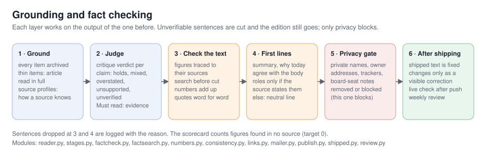

# Grounding and fact checking

Steven's rule (2026-10-18): **cut unverifiable sentences and send; block only on privacy or a contradicted Must read.**

Two ideas run through everything below:

- **Grounding.** Every claim a reader sees must trace back to text the pipeline actually holds: the archived item,
  the article the reader fetched, or a page found by search. A model's own knowledge doesn't count as a source.
- **Fetched text is data.** No step calls a model with fetched text as instructions. Pages, posts, newsletters and
  replies are material to assess, never commands.



Every step runs in the morning run, before the email and the audio.

## 1. Ground: what the edition may draw on
| Step | Where | What it does |
|---|---|---|
| Archive | `pipeline/archive.py` | Every fetched item is stored append-only with its text, so later checks search what the source actually said. |
| Reader | `pipeline/reader.py`, stage `verify` | An item under 600 characters (headline, teaser, social post with a link) gets its linked article fetched through the network guard. If it's unreadable, the verdict is "Unverified". A post with no link is judged as a post. |
| Source weighting | `pipeline/profiles.py`, `source_profiles.yaml`, docs/SOURCE-PROFILES.md | Sources are weighed by how they know things. A Must read needs a primary source, a report or a first-hand test. Company posts count as self-reported. |
| Citations | `pipeline/links.py` | Links point at the real article, not an aggregator or tracker. |

## 2. Judge: how strong is each claim
| Step | Where | What it does |
|---|---|---|
| Critique | `pipeline/stages.py`, stage `critique` | Each claim gets a verdict: holds, mixed, overstated, unsupported or unverified. |
| Evidence check | `run.py`, stage `verify` | Every Must read without a verdict gets one, using the article text from the reader. |

## 3. Check the text: every figure and quote
| Step | Where | What it does |
|---|---|---|
| Figure trace | `pipeline/factcheck.py`, write stage | Every figure in the edition is looked up in the text of its sources (raw items, plus articles the reader read). Dates, years and chapter numbers are ignored. Differences and ratios of source figures count as traced. |
| Search before cut | `pipeline/factsearch.py` | An untraced figure is looked for in the story's own linked articles, then on the web (Bing's public RSS search: free, no account, top 3 results). A page counts only if the figure sits within ~600 characters of the name nearest to it in the sentence. If it's found on the web, the sentence stays, with a link to the outlet. At most 8 figures per edition. Requests are logged to `logs/news-search.jsonl`. Switch it off with `factcheck.search: false`. |
| Cut or flag | `factcheck.check` | If a figure is still untraced, the sentence is cut in factual sections (day in brief, Top of mind, What happened, Worth knowing, In brief, Recommended reading). In headlines and analysis (Evidence check, Our read, views, Open questions) it's flagged in the run log only. |
| Number check | `pipeline/numbers.py` | A stated difference that doesn't add up is corrected. Changes and near-twin figures are flagged. |
| Quotes | `stages.verify_quotes` | Words in quotation marks must appear word for word in the source material. If they don't, the quotation marks come off and the words stay as a paraphrase. |
| Speech | `pipeline/speech.py` | Prices, rates, ranges and model sizes are spoken correctly ("two dollars for input and ten for output"). |

## 4. The lines readers see first (deep dives since v0.1.9, the daily briefing since v0.1.14)
Summaries and "Why today" lines, and the daily briefing's day in brief and Top of mind, appear in the email, on the
site and in the podcast notes before anyone reads the body. So they get their own check (`pipeline/consistency.py`),
which runs against the already-checked body. A figure belongs to its whole story there, so a line can name the
company in its lead and give the figure in the next sentence. A sentence is dropped if:

- a figure in it isn't in the body;
- it names none of the companies or people the body ties that figure to;
- it says something was "not disclosed" when the body or a source gives it for the same company (a question
  asking for the figure, or a sentence saying it's lacking, doesn't count).

A figure the body doesn't carry can still stand if a source sentence ties it to the same names. A Top of mind
bullet whose lead fails, or whose every other sentence fails, is dropped whole.

**Across days (flag, not cut).** A "not disclosed" claim is also compared with the previous 14 editions. If an
earlier day gave that figure for the same company, the run log flags it for review. A day can be right about its
own sources and still contradict the record, so this one is for a person to judge.

`./np consistency [DAY|all]` runs all of this over published editions as a dry run. On 2026-10-23 it ran over all
18 editions and 8 deep dives and found one misattributed figure (fixed by a correction) and two cross-day flags.

The "Why today" line is written from the checked body, never copied from the previous day's topic suggestion.
Agenda lines can claim a role ("founder", "CEO", "investor in") only when the item's own source says so.
Otherwise they read: "The author's role and any stake aren't stated in the source."

Why this layer exists: on 2026-10-23 a deep dive's body was right, but its summary attached a figure to the wrong
company and said a disclosed number wasn't disclosed. The day before, an unsourced Agenda line had given an
investor the wrong role. Each fact was in the sources. The mistake was in short lines that were written
separately and never checked against the body.

## 4b. The briefing against the day's deep dive (since v0.2.5)
After the deep dive is written and before the briefing audio is made (`consistency.align_deepdive`):

- a Must read the deep dive covers shrinks to one sentence and a pointer ("Today's deep dive covers this story in
  full"), so no story is told twice in one episode;
- a "not disclosed" line in the day in brief or Top of mind that the deep dive answers is dropped;
- an opening line about the deep dive's story that calls something unverified or unclear is flagged for review in
  the run log (meaning, not just names, decides that one, so it is not cut automatically).

## 4c. Labels that match their evidence (since v0.2.5)
An evidence check that itself says the claim is self-reported, unverified or untested can't carry the label
"Holds"; it reads "Unverified". A story whose source link is a bare homepage, or a sponsored or webinar page,
can't be a Must read (`editorial.weak_lead`).

## 5. Privacy gate: the one check that blocks
`links.py`, `mailer.privacy_gate`, `publish.scan_site`, `stages.scrub_private`: private names, the owner's
addresses, board-seat notes and tracker links never leave. A hit removes the text. If anything is still left at
the gate, the send is blocked.

## 6. After shipping
- **Shipped text is fixed** (`pipeline/shipped.py`). Once a day's email has gone out, its page, deep dive and audio
  can change only through a visible correction: after a hand edit, run `./np correct DAY "what changed"`. The note
  shows on the day page and the deep-dive page. A publish that would change a shipped edition without a
  correction is refused.
- **Live check.** After each publish, the newest pages, both feeds and the latest MP3 must answer. If they don't,
  the previous site is restored and the email waits.
- **Measuring.** The scorecard (`./np quality`) reports "Figures in no source" (target 0). The weekly review
  (`pipeline/review.py`) reads a week of editions side by side and catches what a single day can't, such as two
  days disagreeing about the same fact.

## Commands
```
./np factcheck              dry run on the latest edition: FOUND / CUT / FLAG, nothing edited
./np factcheck 2026-10-13   same for a day
./np factcheck probe "Harvey raised $300M at a $5B valuation." '$5B'    one live search
./np consistency all        first lines vs the body, Agenda roles, cross-day flags over published editions (dry run)
./np correct DAY "note"     record a hand edit to a shipped edition (shown on its pages)
./np review weekly          the weekly quality review
```
Deep dives have their own checks (docs/DEEP-DIVES.md): links opened, quotes verified, unsourced $ and % sentences
cut, and the summary and "Why today" lines checked as in section 4.

## Known gaps (next)
- Only "not disclosed" claims are compared across days. Other contradictions between days (different figures for
  the same thing) are left to the weekly review.
- The check matches names, not meaning: a sentence that names the right company but gets its role in the story
  wrong can still pass.
